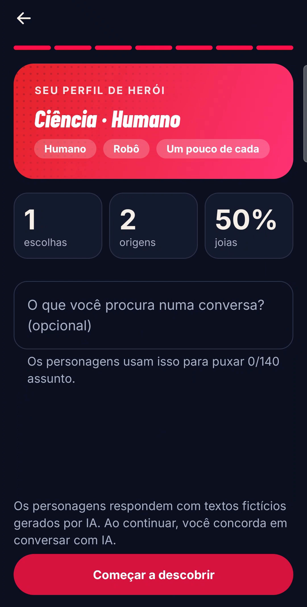

<div align="center">

# Assemble App

**An Android app for discovering comic characters and talking with fictional, AI-generated versions of them.**

[](https://github.com/felipeirl/assemble-app/actions/workflows/android.yml)
[](https://github.com/felipeirl/assemble-app/releases)
[](https://kotlinlang.org/)
[](https://developer.android.com/compose)
[](https://developer.android.com/)
[](LICENSE)

[Screenshots](#screenshots) · [Features](#features) · [How it works](#how-it-works) · [Architecture](#architecture) · [Getting started](#getting-started) · [Releases](#releases)

</div>

---

> [!IMPORTANT]
> This is an independent, non-commercial project. It is not affiliated with, sponsored by, or endorsed by Marvel, Comic Vine, or any publisher. Every conversation is AI-generated fiction; it is not canon and not approved by any publisher.

Each day you get a deck of comic characters. You **Pass** or **Assemble** with each one. When the character also decides on a connection, a conversation opens with a fictional version of them, generated by an AI model. This repository is the Android client. The server lives in [felipeirl/assemble-api](https://github.com/felipeirl/assemble-api).

## Screenshots

<table>
  <tr>
    <td align="center"><br/><sub>Onboarding</sub></td>
    <td align="center"><br/><sub>Daily deck</sub></td>
    <td align="center"><br/><sub>Assemble and compatibility</sub></td>
    <td align="center"><br/><sub>In-character chat</sub></td>
    <td align="center"><br/><sub>Connections</sub></td>
  </tr>
</table>

## Features

- **Sign-in:** e-mail and password, or Google through Credential Manager. E-mail sign-ups must confirm the address before the account opens.
- **Onboarding:** five preference steps (origin, powers, teams, style, fame), a "this or that" round that teaches taste without counting as a decision, and a reveal of your hero profile.
- **Daily deck:** up to 40 characters per day, different for each user. Pass, Assemble, and undo for the last pass. Passed characters return the next day.
- **Assemble:** the server decides from compatibility, the character's affinity with you, and chance. When a character tries to connect first, an in-app notice appears.
- **Chat:** conversations with the fictional version of a character. Suggested replies, regenerate, and rewind. Every reply is labeled as AI-generated fiction.
- **Character profile:** attributes, appearance, team mates, and sources, unlocked after a connection.
- **Profile and achievements:** photo, cover, highlight, frame, title, and editable preferences.
- **Settings:** light, dark, or system theme; sound, vibration, notifications; delete chats or the account (30-day grace period).
- **Languages:** Portuguese and English. Animations respect the system's reduced-motion setting.

## How it works

1. **Discover.** Each card shows the art, the name, a line about the character, and traits you share. Half the deck comes from compatibility with your preferences, and half from taste learned from your decisions.
2. **Decide.** **Pass** dismisses a character. **Assemble** expresses interest.
3. **Assemble.** The server decides once per user–character pair:

   ```
   chance = p1 × compatibility + p2 × persona affinity + p3 × chance
   ```

4. **Talk.** Every reply carries an "AI-generated · fictional" label.

**Principles:** characters, never real people; no sexual content; fiction and facts kept clearly apart; a missing field is omitted, never invented.

### Compatibility

An explainable estimate between your preferences and a character's traits, with weights: Origin 25, Powers 30, Teams 15, Style 20, Fame 10. Choosing "Any" in a category counts half its weight, and rival groups (for example Avengers and X-Men) lose half their weight when nothing is shared. The score only appears after a connection. The table is the same as the server's. It is not a psychological assessment.

## Architecture

```
Android app ──(Firebase token)──▶ Python API (assemble-api)
     │                              ├─ Firestore: users, decisions, connections, messages
     │                              ├─ Catalog (Comic Vine, Marvel Database, Superhero API)
     └─ reads Firestore in real time ├─ Deck, compatibility, and the Assemble decision
                                    └─ AI: LiteLLM + Laya guardrail (input and output)
```

The app **never** stores AI keys and **never** writes scores, connections, messages, or decks; the server does. The `uid` always comes from the Firebase token. Profile photos go to Cloudinary through a signature issued by the server.

### Code layout

```
app/src/main/java/dev/assemble/app/
├── core/
│   ├── designsystem/   theme, typography, colors, icons, components
│   ├── model/          domain models
│   ├── data/           repositories: fake (offline) and remote (Firebase + API)
│   ├── network/        backend HTTP client and photo upload
│   ├── domain/         compatibility, achievements, profile rules (pure functions)
│   ├── firebase/       Auth and Firestore
│   └── media/ ui/ feedback/
├── navigation/         Navigation 3: routes, per-tab back stack, drawer, bottom bar
└── feature/            splash, login, onboarding, discover, character, chat, profile,
                        achievements, settings, account, about, help
```

### Tech stack

| Area | Choices |
| --- | --- |
| UI | Kotlin, Jetpack Compose, Material 3 |
| Navigation | Navigation 3 |
| State | ViewModel and StateFlow |
| Storage | DataStore; Firebase Auth and Cloud Firestore |
| Sign-in | Credential Manager (Google) |
| Images | Coil |
| Tests | JUnit |
| Build | Gradle (Android Gradle Plugin 9.0.0), JDK 17, minSdk 26, targetSdk 36 |

## Getting started

**Requirements:** Android Studio with support for AGP 9.0.0, JDK 17, and an Android device or emulator running Android 8.0 or newer.

```bash
./gradlew assembleDebug        # build
./gradlew testDebugUnitTest    # unit tests
./gradlew installDebug         # install on a connected device or emulator
```

The debug build installs two launchers: **Assemble** (the app) and **Assemble DS** (the internal design-system catalog, debug only).

### With or without the backend

The app picks its mode from `local.properties`, which is git-ignored. Create it at the project root:

```properties
BACKEND_URL=https://your-backend.example.com
FIREBASE_API_KEY=...
FIREBASE_APP_ID=...
FIREBASE_PROJECT_ID=...
GOOGLE_WEB_CLIENT_ID=...
```

- **With `BACKEND_URL` and the three Firebase keys:** the app uses the backend, real sign-in, and Firestore.
- **Without them:** the app runs on fake data on the device. There is no server, no real sign-in, and no real AI. This is enough to explore the screens and run the tests.
- `GOOGLE_WEB_CLIENT_ID` is only needed for Google sign-in.

### Firebase setup

1. Create a project in the [Firebase console](https://console.firebase.google.com/) and add an Android app with the package name `dev.assemble.app`.
2. Enable **Authentication** with e-mail/password and Google. For Google, register the SHA-1 of your debug key (`./gradlew signingReport`).
3. Create **Firestore** in production mode. The region cannot be changed later.
4. Copy `apiKey`, `appId`, and `projectId` into `local.properties`. The app initializes Firebase in code, so **no** `google-services.json` is needed.
5. Publish the security rules from the backend repository (`firestore.rules`).
6. The Admin SDK credential lives only on the backend, never in the app.

## Privacy and data deletion

- **Deleting the account** deactivates it immediately. After a **30-day grace period**, the backend deletes the profile, preferences, decisions, connections, and messages, and removes the user from Firebase Auth. The account can be reactivated during that period.
- **Deleting chats** hides them immediately and removes them after the grace period.
- **Access logs** (IP, date, and time) are kept separately for 6 months, as Brazil's Marco Civil da Internet requires.
- Users consent to AI use at sign-up (`aiConsent`).

> This section describes the product design. It is not legal advice.

## Testing and CI

- Unit tests live in `app/src/test`, and the domain rules (compatibility, achievements, profile) are pure functions, so they are tested without a device.
- The **Android** workflow runs `testDebugUnitTest` and `assembleDebug` on every push to `main` and on every pull request. It needs no secrets: without `local.properties`, the app builds with fake data.
- On failure, the workflow uploads the test report as an artifact.

## Releases

Versions follow an odometer scheme: each release is one meaningful addition, and the number advances one step at a time (`0.0.9 → 0.1.0`). Each version has a tag `vX.Y.Z`, notes in [CHANGELOG.md](CHANGELOG.md), and, where published, a signed APK on the [Releases page](https://github.com/felipeirl/assemble-app/releases).

To cut a release: update `versionName` and `versionCode` in `app/build.gradle`, update the changelog, commit, and create the tag (`git tag -a vX.Y.Z -m "vX.Y.Z"`).

## Credits and licenses

- Character facts and images: [Comic Vine](https://comicvine.gamespot.com/). The app always shows the source.
- Typefaces: Barlow Condensed and Inter, under the SIL Open Font License. Copies are in `app/src/main/assets/licenses/`.
- Sections taken from the Marvel Database (Fandom), when used, follow **CC BY-SA** with attribution.

## Contributing

Issues and pull requests are welcome. Read [CONTRIBUTING.md](CONTRIBUTING.md) first. Report vulnerabilities as described in [SECURITY.md](SECURITY.md).

## License

Released under the [MIT License](LICENSE) © 2026 Felipe Jorge.
